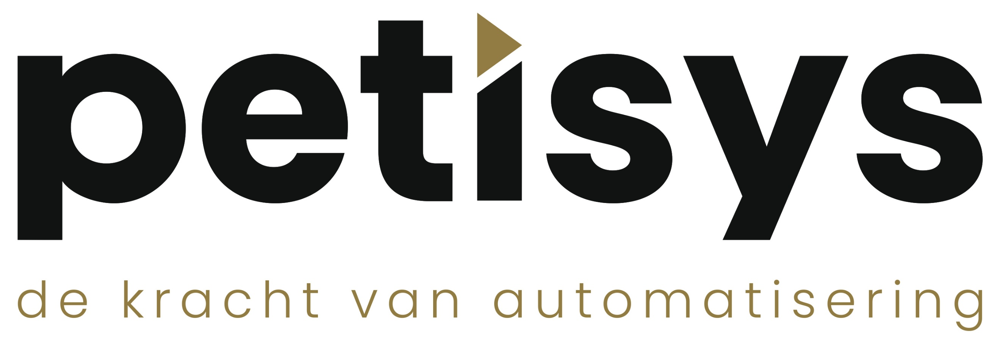

<p align="center"></p>

# PWSpeller

PWSpeller maakt wachtwoorden en wachtzinnen en spelt ze zo dat ze telefonisch foutloos door te
geven zijn. Versie 2 wordt opnieuw gebouwd in Rust voor Windows, macOS en Linux.

## Over dit bestand

- **Doel:** de ingang van het project: wat het is, hoe je het bouwt en waar de rest van de documentatie staat.
- **Klant:** Petisys
- **Gemaakt vanuit:** Petisys
- **Bron:** https://github.com/hpluijm/PWSpeller, release v2.0.0
- **Copyright:** onderaan dit bestand. Overige rechthebbenden: NOTICE.md.

| Wanneer | Wie | Met | Wat |
|---|---|---|---|
| 2026-10-17 | Hans van der Pluijm (Petisys) | Claude Code | Taak 18: sectie Uitrollen/downloaden. |
| 2026-10-16 | Hans van der Pluijm (Petisys) | Claude Code | Verwijzingen naar plan, logboek en bronnen van de woordenlijsten. |
| 2026-10-16 | Hans van der Pluijm (Petisys) | Claude Code | README opnieuw opgezet voor PWSpeller 2 (Rust). |

---

## Wat is het en voor wie

Een programma voor de engineers van Petisys en helpdeskmedewerkers die een wachtwoord aan een
klant doorgeven. De vorige versie (VB.NET, alleen Windows) staat als release
[v1.0-vb](https://github.com/hpluijm/PWSpeller/releases/tag/v1.0-vb).

## Lokaal bouwen

```bash
cargo run -p pwspeller
cargo test --workspace
```

## Uitrollen/downloaden

**Downloaden.** Elke release op [GitHub](https://github.com/hpluijm/PWSpeller/releases) bevat:

| Platform | Bestand |
|---|---|
| Windows x64 | `PWSpeller-<versie>-windows-x64.exe` |
| Windows ARM64 | `PWSpeller-<versie>-windows-arm64.exe` |
| macOS (Apple en Intel) | `PWSpeller-<versie>-macos.zip`, met daarin `PWSpeller.app` |
| Linux x64 | `pwspeller-<versie>-linux-x64` (`chmod +x`, daarna starten) |

**Hoe de release tot stand komt.** Een tag `v*` (bijvoorbeeld `v2.0.0`) start
[`.github/workflows/release.yml`](.github/workflows/release.yml). Die draait de tests en bouwt op een
Windows-, macOS- en Linux-runner, zet de tag als versienummer in het programma
(`PWSPELLER_VERSIE`) en maakt met `gh release create` de GitHub-release met de bestanden. De tekst
van de release is de sectie van die versie uit [RELEASENOTES.md](RELEASENOTES.md), of een
verwijzing ernaar als die sectie ontbreekt. Bij elke push en pull request draait
[`ci.yml`](.github/workflows/ci.yml): opmaak, clippy, tests en `cargo deny` (licenties, verboden
netwerkcrates).

```bash
git tag v2.0.0 && git push origin v2.0.0
```

**Eerste start zonder ondertekening.** De bestanden zijn (nog) niet ondertekend met een
betaald certificaat, dus het besturingssysteem waarschuwt bij de eerste start:

- **Windows:** SmartScreen meldt "Windows heeft uw pc beschermd". Kies *Meer informatie*, daarna *Toch uitvoeren*.
- **macOS:** de app is alleen ad-hoc ondertekend en niet genotariseerd. Rechtsklik op `PWSpeller.app`, kies *Open* en bevestig; of na een eerste mislukte poging *Systeeminstellingen > Privacy en beveiliging > Toch openen*. De app draait in de macOS-sandbox zonder netwerktoegang; instellingen en logboek staan dan onder `~/Library/Containers/nl.petisys.pwspeller/`.
- **Linux:** geen waarschuwing; het bestand moet wel uitvoerbaar zijn. Nodig is een desktop met X11 of Wayland en OpenGL.

Over het ondertekenen en de app stores: zie het [ontwerp](docs/superpowers/specs/2026-10-16-pwspeller-rust-design.md), hoofdstuk 14.

**Lokaal een macOS-bundel maken:** `cargo build --release -p pwspeller` en dan
`packaging/macos/maak-app.sh target/release/pwspeller v2.0.0 .`

## Documentatie

- [RELEASENOTES.md](RELEASENOTES.md): wat er voor de gebruiker verandert
- [deny.toml](deny.toml): toegestane licenties en verboden crates (`cargo deny check`)
- [NOTICE.md](NOTICE.md): AI-tools en overige rechthebbenden
- [docs/implementatie.md](docs/implementatie.md): hoe het in elkaar zit en afgewezen alternatieven
- [docs/voortgang.md](docs/voortgang.md): verloop en beslissingen
- [docs/superpowers/specs/2026-10-16-pwspeller-rust-design.md](docs/superpowers/specs/2026-10-16-pwspeller-rust-design.md): het ontwerp
- [docs/superpowers/plans/2026-10-16-pwspeller-rust.md](docs/superpowers/plans/2026-10-16-pwspeller-rust.md): het implementatieplan, met het [logboek](docs/superpowers/plans/2026-10-16-pwspeller-rust-logboek.md)
- [docs/bronnen/woordenlijsten/](docs/bronnen/woordenlijsten/README.md): de originele woordenlijsten

## AI-ontwikkeltools

Deze code is gebouwd met AI-ontwikkeltools die rechtstreeks in de projectmap en de
git-repository werken: Claude Code (Anthropic) en GitHub Copilot in Visual Studio Code
(GitHub). Welke tool aan een bestand gewerkt heeft, staat in het slotblok van dat bestand.

Waarom zo gewerkt wordt:

- Wijzigingen landen direct in de bestanden en worden vastgelegd in git, zodat elke stap te
  volgen, te reviewen en terug te draaien is.
- Code wordt lokaal gedraaid en getest voordat die gecommit wordt, in plaats van overgenomen
  uit een chatvenster.
- Het hele project (structuur, stijl, bestaande scripts) wordt als context gebruikt, waardoor
  nieuwe code aansluit op wat er al staat.

Eindverantwoordelijkheid voor inhoud, controle en publicatie ligt bij Petisys; de
AI-tools zijn hulpmiddelen, geen auteurs.

---

© 2026 Petisys (opdrachtgever) en Hans van der Pluijm, Petisys (uitvoerder).<br>
Gemaakt met Claude Code (Anthropic). Overige rechthebbenden: NOTICE.md.
